<div align="center">



<br/>

# ESBG Login Test Bot

**A focused Telegram login bot by ESBG. It does one thing only: log in, and show exactly how Telegram delivers the code.**


</div>

---

## Table of Contents

- [Overview](#overview)
- [Features](#features)
- [How It Works](#how-it-works)
- [Bot Preview](#bot-preview)
- [Login Methods](#login-methods)
  - [1. Phone + OTP](#1-phone--otp)
  - [2. API ID / API Hash](#2-api-id--api-hash)
  - [3. Generate Session](#3-generate-session)
  - [4. Paste Session](#4-paste-session)
- [Bot Commands](#bot-commands)
- [Quick Start](#quick-start)
- [Environment Variables](#environment-variables)
- [Deployment](#deployment)
  - [Railway](#railway)
  - [Render](#render)
- [Choosing the Library](#choosing-the-library)
- [Reading the Logs](#reading-the-logs)
- [Troubleshooting](#troubleshooting)
- [FAQ](#faq)
- [Security Guidelines](#security-guidelines)
- [Project Structure](#project-structure)
- [Credits](#credits)

---

## Overview

**ESBG Login Test Bot** is built to find out *why a Telegram login code does not arrive*.
It contains no other features, so the MTProto library can be swapped with a single line in
`requirements.txt` and the results compared under identical conditions (same phone number, same API ID).

The bot offers **four login methods**, registers its command menu in Telegram's **Menu** button at every
start, shows the active **library version** and **Python version** on `/start`, and writes every login step
to the log together with the delivery type Telegram chose (app, SMS, call, ...).

Messages that contain secrets (API Hash, session string, password, code) are **deleted from the chat
immediately**.

## Features

- **Four login methods** - Phone + OTP, your own API ID / API Hash, Generate Session, Paste Session.
- **Code keypad** - tap the digits, delete one, submit, or request a new code; typing the code also works.
- **2-step password support** - the bot asks for the password only when Telegram requires it, and deletes the message at once.
- **Secret hygiene** - every message that contains a code, password, API Hash or session string is deleted from the chat immediately.
- **Delivery report** - each attempt logs how Telegram sent the code (`delivery=APP`, `SMS`, `CALL`, ...).
- **Session strings** - generate one after a login, or verify an existing one without any code.
- **Command menu** - `/start`, `/login`, `/generatesession`, `/pastesession`, `/help`, `/cancel` are registered in Telegram's Menu button at every start.
- **Health page** - a tiny HTTP page on `$PORT` answers for Render / Railway uptime checks.
- **Swappable library** - the MTProto library is a single line in `requirements.txt`.

## How It Works

The full flow for the 📱 Phone + OTP method (methods 🔑 and 🧬 share it; 📋 skips it completely):

1. Send `/start` - the bot shows the main menu with all four methods and the active library.
2. **Choose a method** - tap a button, or send `/generatesession` or `/pastesession` directly.
3. **Phone** - send your number with the country code (e.g. `+919876543210`). The message is deleted at once.
4. **Code** - Telegram decides how the code is delivered; the bot shows that on the code screen. Enter it with
   the keypad, or type it in the chat (separate the digits with spaces). ⌫ deletes, ✅ submits, 🔁 requests a new code.
5. **2-step password** - only if your account has 2-step verification. Send the password; the message is deleted at once.
6. **Result** - a login check for methods 📱 and 🔑, a session string for 🧬, a verified/not-verified screen for 📋.

Everything the bot does is written to the log, one line per step (see [Reading the Logs](#reading-the-logs)).

```mermaid
flowchart TD
    S["/start"] --> M["Choose a login method: Phone + OTP, API ID / API Hash, Generate Session or Paste Session"]
    M --> P["Send phone number with country code, e.g. +919876543210"]
    P --> C["Enter the code: keypad or typed message"]
    C --> T2-step password enabled?
    T -- "Yes" --> W["Send the account password - message deleted at once"]
    W --> R["Result: login check or session string"]
    T -- "No" --> R
```

## Bot Preview

The screens exactly as the bot sends them (HTML bold/italics rendered, sample data for the account name):

**The main menu on /start and /login**

```text
━━━ 🔐 CONNECT YOUR TELEGRAM ACCOUNT ━━━

Choose how to log in:

▸ 📱 Phone + OTP
Quickest: send your number, then the code Telegram gives you.

▸ 🔑 API ID / API Hash
Uses your own key from my.telegram.org. Lower ban risk, and the best choice when the code never arrives.

▸ 🧬 Generate Session
I log you in once and make a session string for you.

▸ 📋 Paste Session
Already have a session string? Paste it and I only check that it works. No code needed.

💡 /cancel to stop.

🔬 Diagnostics: pyrofork 2.3.69 · Python 3.12.6
⚡ Powered by ESBG
```
**Phone + OTP - the quickest way in**

```text
━━━ 📱 PHONE + OTP LOGIN ━━━

▸ Your phone number
Send it with the country code. Example: +919876543210

💡 /cancel to stop.
```
**Your own API key - step 1 of 3**

```text
━━━ 🔑 YOUR OWN API KEY ━━━

Get it free at my.telegram.org → API development tools. It is only used for this login and is not stored.

▸ Step 1 of 3 - API ID
Send your API ID (numbers).

💡 /cancel to stop.
```
**Generate Session**

```text
━━━ 🧬 GENERATE SESSION ━━━

I will log in once and give you a session string to paste back.

▸ Your phone number
Send it with the country code. Example: +919876543210

💡 /cancel to stop.
```
**Paste Session - no code needed**

```text
━━━ 📋 PASTE SESSION ━━━

Paste a ready session string and I will check that it works.

▸ Your session string
Send the whole string as one message. I delete your message at once.

▸ Keep it secret
A session string is the key to your account. Never share it.

💡 /cancel to stop.
```
**The code screen, for APP delivery**

```text
📲 The code was sent inside Telegram: open the chat named Telegram (blue tick) on a phone or computer where this account is already logged in. It is not an SMS.

⚠️ Note: Telegram does not offer an alternative delivery method (SMS / call) for this request.

🔢 Enter the code with the buttons below.
Typing the code in the chat can make Telegram cancel it. If you type it, separate the digits with spaces.

Code: -

Not arriving? Tap 🔁 below, wait a minute, or start /login again and choose 🔑 API ID / API Hash.
```
**2-step password, only when Telegram asks for it**

```text
━━━ 🔐 2-STEP PASSWORD ━━━

Your account has 2-step verification.

▸ Your password
Send it as one message. I delete it at once.

💡 /cancel to stop.
```
**Result of Generate Session**

```text
━━━ 🧬 SESSION GENERATED ━━━

▸ Library
pyrofork 2.3.69

▸ Account
John (@johndoe)

▸ Session string
AbCdEfGhIjKlMnOpQrStUvWxYz0123456789-_AbCdEfGhIjKlMnOpQrStUvWxYz0123456789-_AbCdEfGhIjKlMnOpQrStUvWxYz0123456789-_AbCdEfGhIjKlMnOpQrStUvWxYz0123456789-_AbCdEfGhIjKlMnOpQrStUvWxYz0123456789-_AbCdEfGhIjKlMnOpQrStUvWxYz0123456789-_AbCdEfGhIjKlMnOpQrStUvWxYz0123456789-_AbCdEfGhIjKlMnOpQrStUvWxYz0123456789-_AbCdEfGhIjKlMnOpQrStUvWxYz0123456789-_AbCdEfGhIj

⚠️ This string gives full access to your account. Keep it private and delete this message after saving it. You can verify it with 📋 Paste Session in /start.

💡 /start to begin again.
```
**Result of Paste Session**

```text
━━━ ✅ SESSION VERIFIED ━━━

The session string works.

▸ Library
pyrofork 2.3.69

▸ Account
Stub (@stubuser)

Your message with the string was deleted from this chat.

💡 /start to begin again.
```
**Cancel at any time with /cancel**

```text
━━━ 🚫 CANCELLED ━━━

The current action was stopped.

💡 /start to begin again.
```


## Login Methods

All four methods are everywhere: in the menu, on the buttons, in `/help` and in this README - always in
this order.

### 1. Phone + OTP

The quickest way in: the bot requests the code with **its own** API credentials (the `API_ID` / `API_HASH`
environment variables).

- Send your phone number with the country code, e.g. `+919876543210`.
- Enter the code on the keypad (or type it in the chat, digits separated by spaces).
- If your account has 2-step verification, send your password.
- **You get:** a "LOGIN WORKED" screen - proof that this library can complete a login.

### 2. API ID / API Hash

Uses **your own** key from [my.telegram.org](https://my.telegram.org) instead of the bot's key.

- Get it free at my.telegram.org → *API development tools*. It is only used for this login and is not stored.
- Step 1 of 3: send your **API ID** (numbers).
- Step 2 of 3: send your **API Hash** (32 characters) - the message is deleted at once.
- Step 3 of 3: send your phone number, then the code as in method 1.
- **You get:** a "LOGIN WORKED" screen with your own key.

> **Note:** this method has a **lower ban risk** (the key is yours, not a shared one) and is the **best
> choice when the code never arrives**.

### 3. Generate Session

Same flow as method 1, but the result is different.

- Send `/generatesession` (or tap 🧬 Generate Session), then your phone number, the code, and the password if asked.
- **You get:** a **session string** - the key to your account in one line. Keep it private and delete the
  message after saving it.

### 4. Paste Session

You already have a session string (for example generated here earlier, or by another tool) and just want to
know whether it still works. **No code is needed.**

- Send `/pastesession` (or tap 📋 Paste Session).
- Send the whole string as one message - the bot deletes your message at once.
- The bot starts the session in memory, asks Telegram who it belongs to, and closes it again.
- **You get:** a "SESSION VERIFIED" screen with the library and the account name / username, or an
  "INVALID SESSION" screen with the reason.
- Limits: 5 tries per session, bot sessions are rejected, the string is never stored.

> **Warning:** a session string is the key to your account. Never share it, and never paste it anywhere
> except this private chat.

## Bot Commands

The bot registers these commands in Telegram's **Menu** button (next to the message box) at every start -
no setup in @BotFather is needed. If the registration fails, it is only logged and the bot starts anyway.

| Command | Description |
|---------|-------------|
| `/start` | Open the main menu |
| `/login` | Choose a login method |
| `/generatesession` | Generate a session string |
| `/pastesession` | Check a ready session string |
| `/help` | How the bot works and guidelines |
| `/cancel` | Cancel the current action |

`/start` and `/login` show the same menu. `/generatesession` and `/pastesession` do exactly what the
matching menu buttons do - same state, same screens, same flow. `/help` works in any state and never
interrupts a running login.

## Quick Start

**Prerequisites:** Python 3.12 or newer, a Telegram account of your own, API credentials from
my.telegram.org, and a host (Railway, Render, or any machine that can run Python).

1. **Create a test bot** with [@BotFather](https://t.me/BotFather):
   - send `/newbot`, pick a name and a username;
   - copy the **token** - that is `BOT_TOKEN`;
   - this token is for testing only: **revoke it** (`/revoke` in @BotFather) when testing is finished.
2. **Get your API credentials** at [my.telegram.org](https://my.telegram.org):
   - log in with your phone number, confirm in Telegram;
   - open *API development tools*;
   - copy the **App api_id** (numbers) and the **App api_hash** (32 characters).
3. **Deploy** the project and set `BOT_TOKEN`, `API_ID`, `API_HASH` (see [Deployment](#deployment)).
4. **Test it**: open your bot in Telegram, send `/start`, tap 📱 Phone + OTP, send your number with the
   country code, then enter the code. Try one method at a time.
5. **Read the result**: a success screen tells you the login worked (or gives you the session string);
   an error screen names the reason. What the bot *did* is in the logs (see [Reading the Logs](#reading-the-logs)).
6. **If something fails**: read the error screen and the matching row in
   [Troubleshooting](#troubleshooting), then retry with the suggested fix. Nothing worked? Switch the
   library (see [Choosing the Library](#choosing-the-library)) and test again under the same conditions.

## Environment Variables

| Variable | Required | Description |
|----------|:--------:|-------------|
| `BOT_TOKEN` | Yes | Token of the test bot from @BotFather |
| `API_ID` | Yes | Numeric API ID from my.telegram.org |
| `API_HASH` | Yes | API Hash from my.telegram.org |
| `PORT` | No | Set automatically by Render / Railway; a tiny health page answers on it |

> **Note:** the bot exits at start with a clear message if one of the required variables is missing.

## Deployment

### Railway

1. **New Project** → **Deploy from GitHub repo** → select this repository.
2. Open **Variables** and add `BOT_TOKEN`, `API_ID`, `API_HASH`.
3. The start command is `python main.py` (provided by the included `Procfile`), no other settings needed.
4. Python 3.12 or newer works (the Railway default is fine).
5. Deploy, then open the bot in Telegram and send `/start`.

### Render

1. **New** → **Web Service** → select this repository. Settings are read from `render.yaml`
   (runtime Python, health check path `/`).
2. Add `BOT_TOKEN`, `API_ID`, `API_HASH` under **Environment**.
3. Deploy. After changing the library, use **Clear build cache & deploy** so the new package is really installed.

Both platforms work unchanged: the `Procfile` serves Railway (worker, no port) and `render.yaml` serves
Render (web service with a health page on `$PORT`).

## Choosing the Library

The active library is the **single line** in `requirements.txt`. Test them one after another, with the same
phone number and the same API ID:

| Library | Line in `requirements.txt` | Notes |
|---------|----------------------------|-------|
| **Pyrofork** (default) | `pyrofork==2.3.69` | Newest release on PyPI, known to work |
| Pyrogram | `pyrogram==2.0.106` | Old, code did not arrive |
| Kurigram | `kurigram==2.2.26` | Code did not arrive |

Ready-made copies sit next to `requirements.txt` (`requirements_pyrofork_2.3.69.txt`,
`requirements_pyrogram_2.0.106.txt`, `requirements_kurigram_2.2.26.txt`).

To switch: replace the content of `requirements.txt` with the line you want (or copy one of the
`requirements_*.txt` files over it) and redeploy - on Render use **Clear build cache & deploy**.

> **Warning:** never install two of these libraries together. They provide the same `pyrogram` package and
> break each other's installation.

## Reading the Logs

After requesting a code, the log contains a line like:

```text
login: code requested ... delivery=APP next=SMS
```

| Field | Meaning |
|-------|---------|
| `delivery` | How Telegram sent the code: `APP`, `SMS`, `CALL`, `FLASH_CALL`, `EMAIL_CODE`, ... |
| `next` | The next method Telegram offers if the code does not arrive (empty = no alternative) |

Other useful lines: `login: asking Telegram for a code ... key=bot|own mode=login|generate`,
`login: resend ...`, `login: SUCCESS ...`, `login: SESSION PASTE OK ...`.

When reporting a problem, include this line **for each library tested** and whether the code actually
arrived.

## Troubleshooting

| Symptom | Cause | Fix |
|---------|-------|-----|
| `No matching distribution found for pyrofork==2.4.0` | That version does not exist on PyPI | Keep the default `pyrofork==2.3.69` in `requirements.txt` |
| Code does not arrive | `delivery=APP` means the code is inside Telegram, not an SMS | Open the chat named **Telegram** (blue tick) in the app; tap 🔁 New code and wait a minute; if `next=` is empty there is no alternative - switch to method 🔑 API ID / API Hash |
| `ApiIdInvalid` | The API ID / API Hash pair is wrong | Re-check both values at my.telegram.org, then send the phone number again |
| `ApiIdPublishedFlood` | The API ID is blocked for new logins | Create your own key at my.telegram.org and use method 🔑 API ID / API Hash |
| `FloodWait` | Too many attempts in a short time | Wait the number of seconds shown in the message, then retry |
| `INVALID SESSION` when pasting | The string is incomplete, altered, not a Pyrogram-format session string, or it is a bot session | Paste the whole string as one message; make sure it is the session string of a **user** account |
| Crash at start | `BOT_TOKEN`, `API_ID` or `API_HASH` missing or invalid | Set all three variables and restart; send the first error line from the log if it still crashes |

## FAQ

**Does the bot store my phone number, code, password or session string?**
No. Everything lives in memory for the duration of one login, and restarts wipe it. Messages that contain
secrets are deleted from the chat immediately.

**Where do I get a session string?**
From the 🧬 Generate Session method: log in once, and the bot hands you the string. Or bring one from
another tool and check it with 📋 Paste Session.

**Why does the code arrive in the Telegram app and not as an SMS?**
Telegram decides per request. `APP` is the most common delivery when the account is already logged in
somewhere. The code screen tells you exactly where to look, and the log line shows `delivery=`.

**Why does the bot need my 2-step password?**
Only if your account has 2-step verification enabled - Telegram requires it to finish the login. The
message with the password is deleted immediately, and nothing is stored.

**Which method should I try first?**
📱 Phone + OTP. If the code never arrives, 🔑 API ID / API Hash is the best alternative - it also has a
lower ban risk because the key is your own.

**Can I test with a friend's number?**
No. Use your own accounts only (see [Security Guidelines](#security-guidelines)).

**Can the bot run without `API_ID` / `API_HASH`?**
No. All three variables (`BOT_TOKEN`, `API_ID`, `API_HASH`) are required, even if you only use method 🔑.

**What is the difference between 📱 Phone + OTP and 🧬 Generate Session?**
The login flow is identical. Method 📱 ends with a "LOGIN WORKED" check, method 🧬 ends with a session
string you can keep.

## Security Guidelines

Do:

- use **your own accounts and your own API key**;
- use a **separate test bot** and revoke its token (`/revoke` in @BotFather) when testing is finished;
- delete the message that shows your session string after saving it;
- keep `BOT_TOKEN`, `API_ID`, `API_HASH` in the platform's environment settings, never in the repository.

Never:

- **never share a session string** - it is the key to the whole account, anyone who has it can read and
  write every chat;
- never paste a session string into a group, a website, or another bot;
- never use accounts or numbers that are not yours;
- never commit `BOT_TOKEN`, `API_HASH` or session strings to Git;
- never run the bot for other people - it is a diagnostic tool, not a service.

## Project Structure

```text
login_test_bot/
├── assets/
│   └── banner.svg                  # animated README banner (SVG SMIL, no JavaScript)
├── main.py                         # the bot (login flows, commands, health page)
├── requirements.txt                # active library (one line: pyrofork==2.3.69)
├── requirements_pyrofork_2.3.69.txt
├── requirements_pyrofork_latest.txt
├── requirements_pyrogram_2.0.106.txt
├── requirements_kurigram_2.2.26.txt
├── Procfile                        # Railway / Heroku-style start command
├── render.yaml                     # Render service definition
└── README.md
```

## Credits

- **Built by ESBG.**
- [Pyrofork](https://github.com/pyrofork/pyrofork) - the maintained Pyrogram fork this project ships with,
  and the whole Pyrogram ecosystem it belongs to.
- [Telegram Bot API](https://core.telegram.org/bots/api) and
  [my.telegram.org](https://my.telegram.org) - the credentials every login is based on.
- [Railway](https://railway.app) and [Render](https://render.com) - the one-click hosts this bot is
  configured for.

---

<div align="center">
<sub><b>Made by ESBG</b> - a login diagnostic tool. Use it only with your own accounts, and keep every session string to yourself.</sub>
</div>
