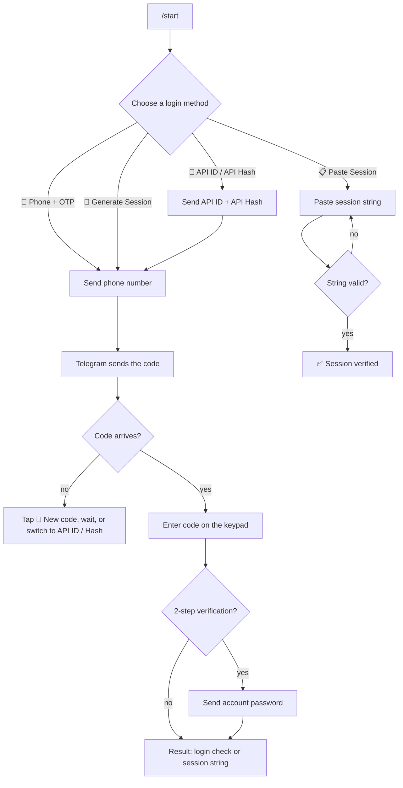

<div align="center">


# Login Bot

**Sign in to a Telegram account and see exactly how the login code is delivered.**


[Overview](#overview) · [Features](#features) · [How It Works](#how-it-works) · [Bot Preview](#bot-preview) · [Photo Rotation](#photo-rotation) · [Login Methods](#login-methods) · [Bot Commands](#bot-commands)

[Quick Start](#quick-start) · [Environment Variables](#environment-variables) · [Deployment](#deployment) · [Choosing the Library](#choosing-the-library) · [Reading the Logs](#reading-the-logs) · [Troubleshooting](#troubleshooting) · [FAQ](#faq) · [Security Guidelines](#security-guidelines) · [Credits](#credits)

</div>

---

## Overview

Login Bot signs a Telegram account in and shows every step of the login in plain language. It is built around one idea: you should always know **what Telegram did with your login code** - whether it went to the Telegram app, an SMS, a phone call or an email - instead of staring at a silent phone.

The bot offers four ways to sign in:

1. **Phone + OTP** - the quickest way. Send your number, then the code Telegram gives you.
2. **API ID / API Hash** - uses your own key from my.telegram.org. Lower ban risk, and the best choice when the code never arrives.
3. **Generate Session** - the bot makes a session string for you after you log in once.
4. **Paste Session** - you already have a session string: paste it and the bot only checks that it works, no code needed.

Anything sensitive - the code, your password, your API Hash, a session string - is **deleted from the chat the moment you send it**. A rotating photo from the built-in gallery tops every screen, so no two replies look the same. The bot runs as a worker on **Railway** or as a web service on **Render** and needs no other infrastructure.

## Features

- **Four login methods** in one menu - phone OTP, your own API key, session generation, session verification.
- **Live delivery line** - after the code is requested, the bot tells you where Telegram sent it (app, SMS, call, missed call, email) and which method comes next.
- **Code keypad** - enter the code with buttons, delete a digit with ⌫, submit with ✅, or ask for a fresh code with 🔁.
- **2-step verification support** - if your account has a password, the bot asks for it and deletes the message instantly.
- **Session strings made and verified** - generate a string after one login, or paste an existing one and have it checked without a code.
- **Rotating photos** - a fresh login / nature picture above every command and button reply, shuffled so nothing repeats too soon.
- **Secrets never stay in the chat** - messages that contain secrets are deleted at once.
- **Self-registering command menu** - the Telegram "Menu" button is filled automatically at every start.
- **One-line library switching** - the whole MTProto stack is the single line in `requirements.txt`.
- **Deployment friendly** - health page on `$PORT` for Render, worker start for Railway, clear logs for every step.

## How It Works

1. Send **/start** - the bot opens the main menu with the four methods.
2. Choose a method - each method has its own step-by-step screens.
3. Send your phone number (and, for method 2, your API ID and API Hash first).
4. Telegram sends the login code - the bot shows **where it was sent**.
5. Enter the code on the keypad and press **✅ Submit** (or tap 🔁 for a new code).
6. If your account has a 2-step password, send it - the message is deleted immediately.
7. You get the result: a login confirmation, a session string, or a verified session.



## Bot Preview

Every reply is a **rotating photo with the text as its caption**; the buttons sit under the message. The screens below show the text exactly as the bot writes it.

**/start - the main menu**

```text
━━━ 🔐 LOGIN BOT ━━━

Sign in to a Telegram account and see exactly how the login code is delivered.

Choose how to log in:

▸ 📱 Phone + OTP
The quickest way. Send your number, then the code Telegram gives you.

▸ 🔑 API ID / API Hash
Uses your own key from my.telegram.org. Lower ban risk, and the best choice when the code never arrives.

▸ 🧬 Generate Session
Log in once and the bot makes a session string for you.

▸ 📋 Paste Session
Already have a session string? Paste it and I only check that it works. No code needed.

💡 Tip: if the code never arrives, choose 🔑 API ID / API Hash.

⚙️ Powered by ESBG

[📱 Phone + OTP] [🔑 API ID / API Hash] [🧬 Generate Session]
[📋 Paste Session] [❓ Help] [❌ Close]
```

**Method introductions**

```text
━━━ 🧬 GENERATE SESSION ━━━

I will log in once and give you a session string to paste back.

▸ Your phone number
Send it with the country code. Example: +919876543210

💡 /cancel to stop.

━━━ 📋 PASTE SESSION ━━━

Paste a ready session string and I will check that it works.

▸ Your session string
Send the whole string as one message. I delete your message at once.

▸ Keep it secret
A session string is the key to your account. Never share it.

💡 /cancel to stop.

━━━ 🔑 YOUR OWN API KEY ━━━

Get it free at my.telegram.org → API development tools.
It is only used for this login and is not stored.

▸ Step 1 of 3 - API ID
Send your API ID (numbers).

💡 /cancel to stop.
```

**The code screen**

```text
━━━ 🔢 ENTER THE CODE ━━━

📲 The code was sent inside Telegram: open the chat named Telegram (blue tick) on a
phone or computer where this account is already logged in. It is not an SMS.

🔢 Enter the code with the buttons below.
Typing the code in the chat can make Telegram cancel it. If you type it, put a space between the digits.

Code: -

Not arriving? Tap 🔁 below, wait a minute, or start /login again and choose 🔑 API ID / API Hash.

💡 /cancel to stop.

[1] [2] [3]          [4] [5] [6]          [7] [8] [9]
[⌫] [0] [✅ Submit]  [🔁 New code] [❌ Cancel]
```

**Results**

```text
━━━ 🧬 SESSION GENERATED ━━━

Account: Alice
Library: pyrofork 2.3.69

Your session string
Ab1zXk9...=

▸ Keep it secret
This string gives full access to your account. Save it somewhere safe and delete this message.

You can check it any time with 📋 Paste Session.

━━━ ✅ SESSION VERIFIED ━━━

Library: pyrofork 2.3.69
Account: Alice (@alice)

The session works. No code was needed.

▸ Keep it secret
A session string is the key to your account. Never share it.
```

## Photo Rotation

Every command reply and every button reply shows a **new photo** on top of the message, with the screen text as the caption and the buttons underneath.

**How the rotation works**

- Every picture is shown once before any picture repeats (a "shuffle bag" per user), and the same picture is never shown twice in a row.
- Login / security pictures and nature pictures are mixed, so they roughly alternate.
- A new picture is picked for every command reply and every button reply - including 🔁 New code, ✅ Submit results and ❌ Cancel.
- The exception: pressing a keypad digit or ⌫ only updates the text, so the picture does not flicker (this is the `ROTATE_ON_KEYPAD` switch in `main.py`).
- Each picture is uploaded once and cached by its Telegram file id, so later screens are instant.

**Accepted formats**

| Always supported (no extra package) | Supported when Pillow is installed |
|-------------------------------------|------------------------------------|
| JPG, JPEG, JFIF, PNG, WebP          | GIF, BMP, TIFF and anything else Pillow can open |

The format is detected from the file's first bytes, not from its name - a PNG named `.jpg` still works. Files that Pillow converts are re-encoded to JPEG once at start, and oversized pictures are downsized automatically. Corrupt, empty or hidden files are skipped with a warning instead of crashing the bot. If a picture fails to send, it is removed from the rotation for the rest of the run and the screen is sent anyway.

> **Note:** to enable GIF / BMP / TIFF, add a second line with just `pillow` to `requirements.txt`. Pillow is an image library, not a Telegram library, so the one-library rule stays intact.

**Using your own pictures**

1. Drop your pictures into `assets/photos/login/` (login / security themed) or `assets/photos/nature/`.
2. Any common format works; file names do not matter.
3. Restart the bot - the gallery is read once at start. Removed files simply stop appearing.

Set the environment variable `PHOTOS=off` to send every screen as plain text instead. If the folder is empty or a photo fails, the same screen is delivered as a normal text message with the same buttons - the login flow never depends on photos.

The 24 pictures included with the bot are original artwork drawn for this project:

<p align="center"></p>

> **Note:** a photo caption in Telegram is limited to 1,024 characters. Every screen is written to fit; the long /help guide is sent as a photo with a short caption plus the full guide as a second message.

## Login Methods

<a id="method-1"></a>

### 1. Phone + OTP

The quickest way in. You send your phone number with the country code, Telegram sends a one-time code, you enter it on the keypad. If your account has a 2-step password you send it afterwards. The result is a login confirmation and a session string you can save. This method uses the API ID / API Hash that the bot's owner configured.

<a id="method-2"></a>

### 2. API ID / API Hash

The same flow, but the login is created with **your own** API key from [my.telegram.org](https://my.telegram.org) (API development tools). You send the API ID (numbers), then the API Hash (32 characters), then your phone number and the code. Telegram treats the login as coming from your own application, which carries a lower ban risk - and this is the method to pick when the code never arrives with method 1. The key is only kept in memory for this login and is not stored.

<a id="method-3"></a>

### 3. Generate Session

Available from the menu or with **/generatesession**. You log in once (phone number → code → optional 2-step password) and the bot replies with a ready session string. Save it somewhere safe - it grants full access to the account - and delete the message afterwards.

<a id="method-4"></a>

### 4. Paste Session

Available from the menu or with **/pastesession**. You already have a session string and just want to know whether it still works:

1. Paste the whole string as one message.
2. The bot deletes your message at once and starts a temporary client with the string.
3. If the session opens and belongs to a user account, you get a **SESSION VERIFIED** screen with the account name; otherwise you get an **INVALID SESSION** screen with the reason.

No code and no password are needed. After five failed attempts the bot stops for that round. A session string is the key to the account - never paste one you do not own, and never share one that is yours.

## Bot Commands

The bot fills Telegram's **Menu** button by itself at every start - nothing to set up in @BotFather.

| Command | Description |
|---------|-------------|
| `/start` | Open the main menu |
| `/login` | Choose a login method |
| `/generatesession` | Generate a session string |
| `/pastesession` | Check a ready session string |
| `/help` | How the bot works and guidelines |
| `/cancel` | Cancel the current action |

`/help` works in the middle of a login too and never breaks the flow.

## Quick Start

1. **Create a bot** with [@BotFather](https://t.me/BotFather): send `/newbot`, pick a name and a username, and copy the token.
2. **Get API credentials** at [my.telegram.org](https://my.telegram.org) → *API development tools* → note the **API ID** and **API Hash**.
3. **Deploy** the project on Railway or Render (see [Deployment](#deployment)) and set the environment variables.
4. Open your bot in Telegram, send **/start**, choose a method and follow the screens.
5. When you are done testing, revoke the bot token in @BotFather (`/revoke`).

## Environment Variables

| Variable | Required | Description |
|----------|:--------:|-------------|
| `BOT_TOKEN` | Yes | Token of your bot from @BotFather |
| `API_ID` | Yes | Numeric API ID from my.telegram.org |
| `API_HASH` | Yes | API Hash from my.telegram.org |
| `PORT` | No | Set automatically by Render / Railway; a tiny health page answers on it |
| `PHOTOS` | No | `on` (default) or `off` - turns the rotating photos off |

## Deployment

### Railway

1. Push the project to GitHub, then in Railway: **New Project** → **Deploy from GitHub repo** → select the repository.
2. Open **Variables** and add `BOT_TOKEN`, `API_ID`, `API_HASH`.
3. Deploy. The included `Procfile` starts the bot with `worker: python main.py` - no port needed.
4. Check the deploy logs: the bot prints its library version and the registered commands.

### Render

1. In Render: **New** → **Web Service** → connect the repository. The included `render.yaml` provides the settings.
2. Add `BOT_TOKEN`, `API_ID`, `API_HASH` under **Environment**.
3. Deploy. Render sets `PORT` automatically; the bot answers on it with a tiny health page, so the service shows as alive.
4. If you change the library later, use **Clear build cache & deploy**.

## Choosing the Library

The MTProto library is the **single line** in `requirements.txt`. Ready-made alternatives ship with the project; copy the line you want and redeploy.

| Library | Line in `requirements.txt` | Notes |
|---------|----------------------------|-------|
| **Pyrofork** (default) | `pyrofork==2.3.69` | Newest release on PyPI, known to work |
| Pyrogram | `pyrogram==2.0.106` | Old, code may not arrive |
| Kurigram | `kurigram==2.2.26` | Alternative fork |

> **Warning:** never install two Telegram libraries together - their modules collide and the bot crashes at start. Exactly one library line, always.

> **Warning:** do not "upgrade" to `pyrofork==2.4.0` - that version does not exist on PyPI and the deployment fails with `No matching distribution found for pyrofork==2.4.0`.

## Reading the Logs

After each code request the log contains a line like this:

```text
login: code requested uid=... library=pyrofork 2.3.69 key=bot mode=login delivery=APP next=SMS timeout=120
```

| Field | Meaning |
|-------|---------|
| `delivery` | Where Telegram sent the code: `APP` (inside the Telegram app), `SMS`, `CALL`, `FLASH_CALL`, `MISSED_CALL`, `EMAIL_CODE`, `FRAGMENT_SMS` |
| `next` | The alternative method Telegram offers if the code does not arrive |
| `key` | Whose API credentials the login used: `bot` or `own` |
| `mode` | `login` (account check) or `generate` (session string) |

`APP` delivery is the most common reason for "no code": the code is **not** an SMS. Open the chat named **Telegram** (blue tick) on a device where that account is already logged in.

## Troubleshooting

| Symptom | Cause | Fix |
|---------|-------|-----|
| Build fails: `No matching distribution found for pyrofork==2.4.0` | That version does not exist on PyPI | Keep `pyrofork==2.3.69` |
| `ApiIdInvalid` when requesting the code | API ID / API Hash is wrong | Re-check both values at my.telegram.org, or use the bot's own key (method 1) |
| `ApiIdPublishedFlood` | The API ID is publicly flooded and blocked by Telegram | Create your own API key and use method 2 |
| `FloodWait` / "Too many attempts" | Too many code requests | Wait the number of seconds shown, then try again |
| Code never arrives | `delivery=APP`: the code is inside the Telegram app, not an SMS | Open the chat named **Telegram** (blue tick) on a logged-in device; tap 🔁 New code; or restart with method 2 |
| `INVALID SESSION` after pasting a string | The string is truncated, mistyped, expired, or from a bot account | Copy the whole string again in one message; bot sessions are rejected |
| Photos not showing | `PHOTOS=off`, empty folder, or Telegram rejected a file | Check the `photos:` log lines; the bot falls back to text screens automatically |
| Crash at start | Missing environment variable or two Telegram libraries installed | Set `BOT_TOKEN`, `API_ID`, `API_HASH`; keep exactly one library line in `requirements.txt` |

## FAQ

**Where is my login code?**
Check the delivery line on the code screen. If it says the code went to the app, look for the chat named **Telegram** (blue tick) on a phone or computer where that account is already signed in. It is not an SMS.

**Why did my code get cancelled?**
Typing the code as a normal chat message can make Telegram cancel it. Use the keypad buttons, or type the digits separated by spaces.

**Does the bot store my password or my API Hash?**
No. The message is deleted from the chat immediately and nothing is written to disk. The API Hash only lives in memory for that one login.

**What is a session string?**
A text key that lets a program open your Telegram account without a new login code. It is as powerful as your password - keep it private, and only paste strings that belong to you.

**Can I log in to someone else's account?**
No. Use the bot only with your own accounts.

**Can I use my own pictures?**
Yes - drop them into the photo folders and restart. Any common format works; see [Photo Rotation](#photo-rotation).

**Railway or Render?**
Both work out of the box. Railway runs the bot as a worker; Render runs it as a web service and uses the health page on `$PORT`.

**Why does /help not reset my login?**
/help is only a guide - it never touches an ongoing login, so you can read it mid-flow.

## Security Guidelines

- A **session string is the key to the account.** Never share it, never post it in a chat, and delete any message that shows it after saving it.
- **Revoke the bot token** when testing is over: @BotFather → `/mybots` → the bot → API Token → Revoke.
- **Use only your own accounts.** Logging in to accounts you do not own is not what this bot is for.
- Never commit `BOT_TOKEN`, `API_HASH` or session strings to the repository - set them as environment variables in the dashboard.
- The bot deletes every message that contains a secret (code, password, API Hash, session string) the moment it arrives.

## Credits

<div align="center">

**Made by ESBG**

Built for Telegram account login checks and session work.
The included photos and the animated banner are original artwork created for this project.

*Use only with your own accounts. The authors are not responsible for misuse.*

</div>
